# Callable CMS Steepener: Pricing, Risks, Hedging and Back-tests on Market Data

I took a real structured note, Goldman Sachs' **Ten-Year EUR Callable Fixed-to-Steepener Notes due
2036** (ISIN XS2061620741, term sheet in `termsheets/`), and priced it on **Bloomberg data from
29 October 2026**, two months after it was issued. I wanted to answer four questions:

1. What is the note really worth, and how much did the investor pay for the structure?
2. Is it a good deal for the client compared with a plain Goldman bond?
3. What risks does the desk keep after selling it, and can it hedge them?
4. How would the note and the hedge have behaved through 22 years of real EUR rates?

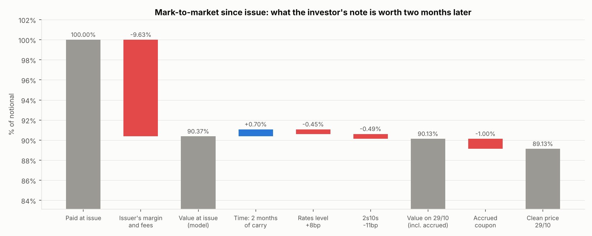

**In short:**
- The note is worth **90.1%** on 29/10/2026 (89.1% clean) against an issue price of 100% two months earlier.
  Almost all of the gap was already there on day one. Rates moved very little since issue.
- The curve is almost flat today (EUR 2s10s = 8bp), so the forward 2s10s sits below the 40bp floor
  kink: the investor mostly owns a 2% coupon plus options on a steeper curve.
- For a client buying at 100%, the expected return is about **3.7% a year**, against **5.1%** for a
  plain 10-year Goldman bond. The note only beats the bond in 1 scenario out of 10.
- The desk's main risk is the 2s10s slope and the 2Y/10Y correlation. Hedging DV01 and slope with
  2Y and 10Y swaps cuts the spread of its P&L across 147 back-tested notes from 6.7% to 2.7% of notional.

## The product

| | |
|---|---|
| Issuer | Goldman Sachs Finance Corp International, guaranteed by The Goldman Sachs Group |
| Size, dates | EUR 80m, issued at 100% on 1 Sep 2026, matures 1 Sep 2036 |
| Years 1-2 | 6% fixed |
| Years 3-10 | 5 x (EUR 10Y swap rate - EUR 2Y swap rate), floored at 2%, capped at 6% |
| Call | Goldman can repay at par every 1 September from 2028 to 2035 |
| Capital | 100% at maturity (Goldman credit risk) |

The investor bets that the curve stays steep. Each floating coupon is a floor plus a leveraged
call spread on the 2s10s spread: 2% + 5 x [(S - 0.40%)+ - (S - 1.20%)+]. The coupon sits at the
2% floor below 40bp of slope and reaches the 6% cap above 120bp.

## Data

| Data | Source | Used for |
|---|---|---|
| EUR swaps vs Euribor 6M (1-10Y) and ESTR OIS swaps (1-30Y), 29/10/2026 | Bloomberg (EUSA, EESWE) | the two curves |
| EUR swaption ATM normal vol cube (19 expiries x 12 tenors) | Bloomberg VCUB | checking the G2++ model |
| Swaption smiles of the 2Y and 10Y swaps (-300bp to +300bp) | Bloomberg VCUB | SABR, CMS convexity, copula |
| GS 5.35% 2035 note (yield 6.11-6.38%) and USD SOFR swaps | Bloomberg | Goldman's credit spread: **168bp** |
| EUR 2Y and 10Y AAA par yields, daily since Sep 2004 | ECB data portal | correlation, stress tests, back-tests |

The Bloomberg quotes are licensed, so **they are not in this repo** (`data_bloomberg/` is
gitignored). The ECB history is public and is in `data/ecb/`. The charts and model outputs in
`results/` are mine.

Where data was missing, I used simple rules: Euribor beyond 10Y = ESTR + the 10Y basis (23bp),
missing tenors interpolated, and one flat 2Y/10Y correlation taken from the ECB history (0.84),
because nobody quotes CMS spread options.

## What I did

1. **Market.** I bootstrapped the ESTR and Euribor 6M curves and fitted a normal SABR to each smile
   (errors below 3bp of vol). I then calibrated a two-factor G2++ model and checked it on the whole cube.
2. **Pricing.** I priced the coupons on the smile with a Gaussian copula and the convexity adjustment.
   I priced Goldman's call with G2++ Monte Carlo and Longstaff-Schwartz, and split the note into
   building blocks.
3. **Mark-to-market.** I explained the move from issue to 29/10 by carry, rates level and slope.
4. **Correlation.** I measured the historical 2Y/10Y correlation and showed how the price depends on it.
5. **Investor view.** I computed the distribution of the client's return and compared it with a
   Goldman fixed-rate bond.
6. **Structuring.** I showed Goldman's margin for each funding level and what moves the leverage.
7. **Risks.** I computed the Greeks by bump-and-revalue, key rates, vega buckets, profiles and
   historical stress tests, and designed a swap hedge.
8. **Back-tests on 2004-2026.** I launched the note every month and looked at:
   the investor's IRR, the desk's P&L with three hedges, and a monthly P&L explain.

```bash
pip install -r requirements.txt
python run_analysis.py           # about 3 minutes, 24 charts and the tables go to results/
python -m pytest -q              # 10 tests (the Bloomberg ones are skipped without the data)
```

## Results

### 1. The market on 29/10/2026

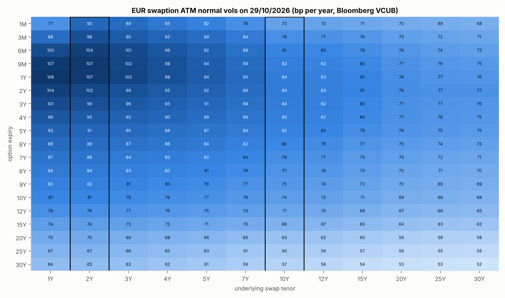

The EUR curve is very flat: 3.38% for the 2Y swap, 3.46% for the 10Y. The forward 2s10s at each
coupon fixing is only 7 to 20bp (`01_curves.png`). The CMS convexity adds 6 to 23bp to the 10Y rate
and 1 to 3bp to the 2Y, which lifts the expected spread to 12-34bp. That is still below the 40bp
floor kink.

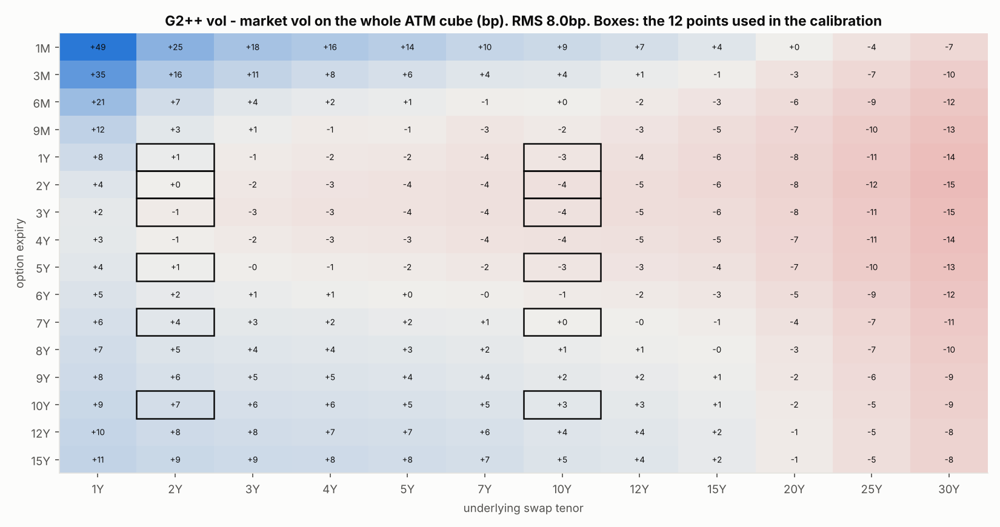

G2++ fits the 12 vols it is calibrated on within 3.3bp, but the whole cube only within 8bp. It is
too high on short expiries and too low on long swaps. It also overestimates the 2Y/10Y correlation
by 4 points at 5 years and 8 points at 9 years. This is why I only use G2++ for the call and take
the coupons from SABR + copula.

### 2. What the note is worth

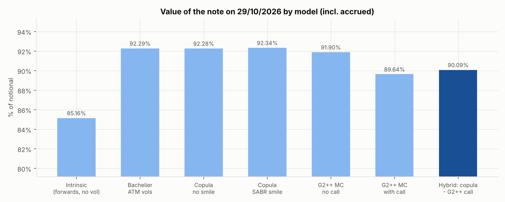

| Model | Value |
|---|---|
| Intrinsic (forwards, no vol) | 85.2% |
| Copula on SABR, no call | 92.3% |
| G2++, with the call | 89.6% |
| **Hybrid: copula - G2++ call value** | **90.1%** (± 0.02%) |

The 7 points between the intrinsic value and the copula are the optionality: the coupons are
options on a steeper curve, and on a flat curve they are mostly out of the money.

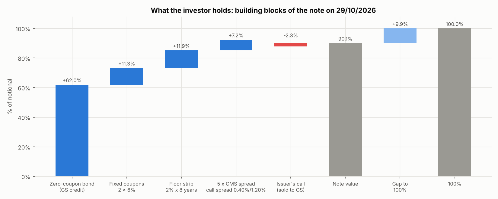

62% of the value is a 10-year Goldman zero-coupon bond, 11% the two 6% coupons and 12% the 2%
floor. The steepener itself (five call spreads on 2s10s) is worth only 7%, and the investor gives
2.3% back through the call.

**Mark-to-market** (chart at the top): the note was worth 90.4% on the day it was sold at 100%. The
9.6% gap is Goldman's margin, the distributor's fees and the credit spread I use. Since then:
2 months of carry +0.7%, rates +8bp -0.45%, curve 11bp flatter -0.5%.

### 3. Correlation

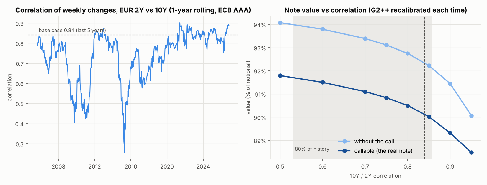

The 1-year correlation of weekly changes in the 2Y and 10Y rates has moved between 0.26 (2015)
and 0.90 (2021). My base case is the 5-year average, 0.84. Every point of correlation costs the
investor about 0.11% of notional: the callable note goes from 91.8% at 0.5 correlation to 88.5% at 0.95.
Even at 0.5, the note never gets close to 100%.

### 4. The client's view

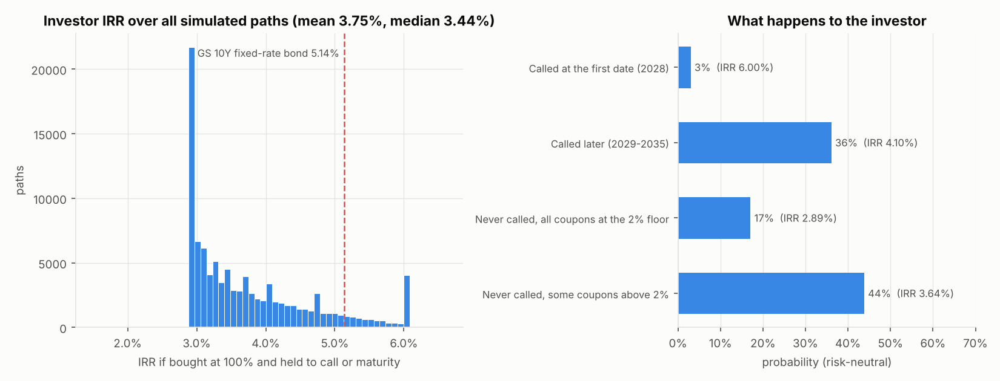

For a client buying the note today at 100% and holding it, the simulated IRR has a mean of 3.75%
and a median of 3.44%. A plain 10-year Goldman bond would pay 5.14% (10Y swap + 168bp).

| Scenario | Probability | Average IRR |
|---|---|---|
| Called at the first date (2028) | 3% | 6.0% |
| Called later (2029-2035) | 36% | 4.1% |
| Never called, all coupons at 2% | 17% | 2.9% |
| Never called, some coupons above 2% | 44% | 3.6% |

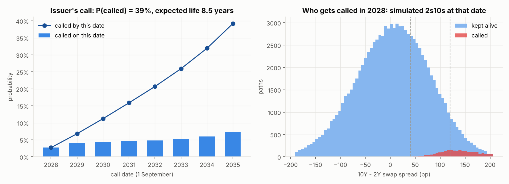

The call probability is 39% and the expected life is 8.5 years. Goldman calls when the curve has
steepened (right chart), which is exactly when the investor would earn 5-6%. The investor keeps the
bad scenarios and loses the good ones. The probabilities are risk-neutral, not forecasts.

### 5. Structuring: Goldman's margin

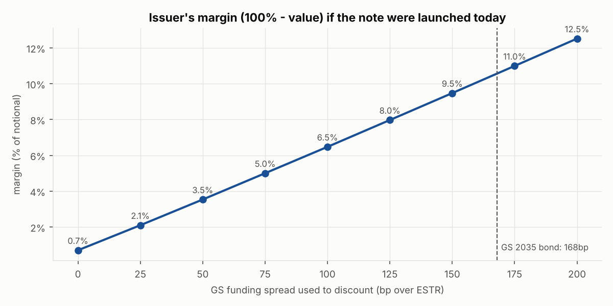

The margin depends mostly on the spread Goldman uses to discount. With the 168bp of its 2035 note
(a small, illiquid retail note), the margin would be over 10%. If Goldman funds itself at 75-100bp,
it is 5-6.5%, which is more typical for retail structured notes. The note would only be worth 98%
with a funding spread of about 23bp.

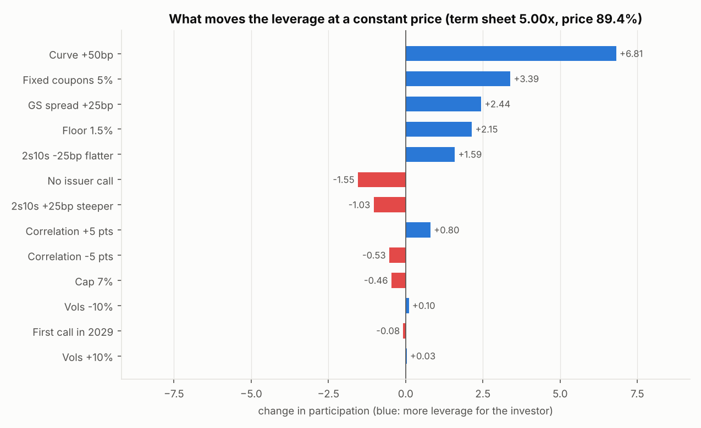

To keep the same price, Goldman could offer much more leverage if rates were 50bp higher (11.8x
instead of 5x), with 5% instead of 6% fixed coupons (8.4x) or with a 1.5% floor (7.1x). Removing the
call would cost 1.5x. The vol level barely matters, because the investor is long vol in the
coupons and short vol in the call.

### 6. Desk risks

In bp of notional, for the investor (the desk holds the opposite):

| | Without the call | With the call |
|---|---|---|
| Rates +1bp | -7.2 | -5.8 |
| 2s10s +1bp | +5.4 | +4.1 |
| Vols +1bp | +6.3 | **+1.6** |
| Correlation +1 pt | -11.7 | -11.0 |
| GS spread +1bp | -7.4 | -6.0 |

What is left is mainly **slope and correlation** risk. Correlation cannot be hedged with vanilla
swaptions, so it is the risk the desk really keeps.

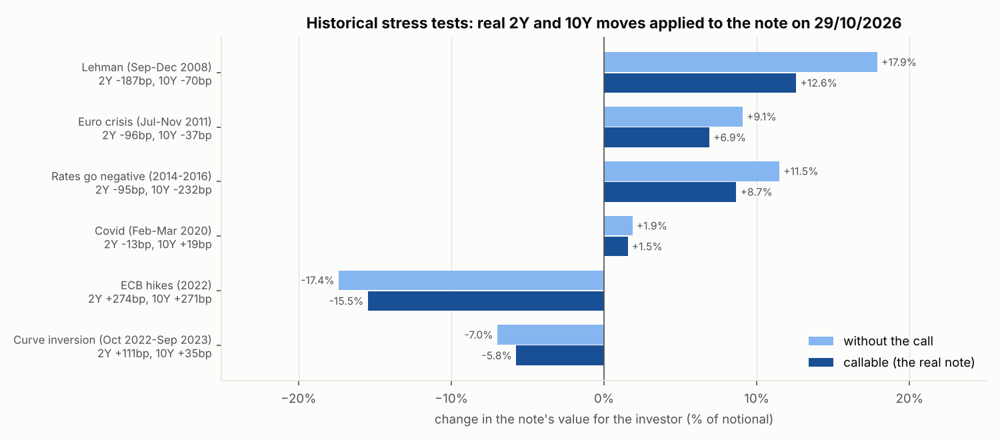

I applied real moves of the 2Y and 10Y rates to today's note. The worst case is a 2022-style hiking
cycle (-15.5%), because of the rates level, not the slope. A Lehman-type rally with a steeper curve
is the best case (+12.6%), and the call cuts that gain by a third.

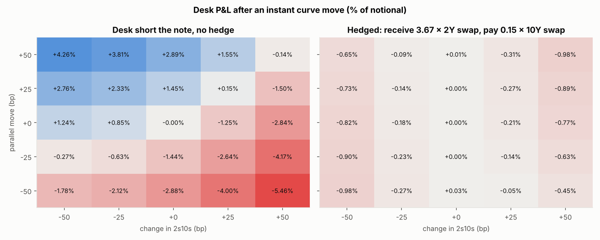

To cancel its DV01 and its 2s10s risk, the desk receives fixed on 3.67 x notional of 2Y swaps and
pays fixed on 0.15 x notional of 10Y swaps. For curve moves of up to ±50bp in level and slope, the
desk's P&L goes from up to ±5.5% of notional to less than 1%.

### 7. Back-tests on 22 years of ECB data

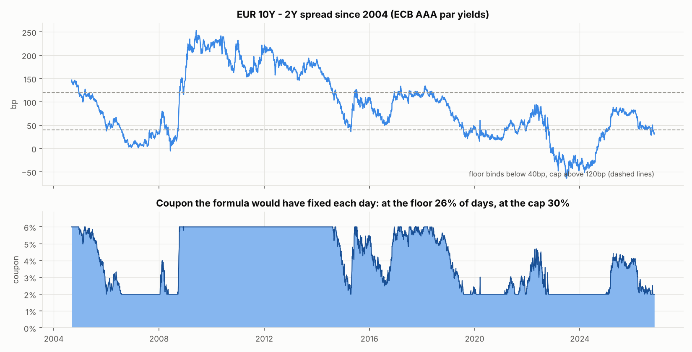

Since 2004 the EUR 2s10s has averaged 90bp. The coupon formula would have been at the floor on
26% of days and at the cap on 30%. Today's curve is much flatter than the historical average.

For the back-tests, I launched the note at the end of every month from Sep 2004 to Nov 2016 (147 notes
with a full 10-year history). I shifted each note's rates so that its 10Y rate starts at today's
level. The slope and all the monthly moves stay historical. I repriced the note every month with a
simple closed-form model:
- a linear curve between the 2Y and 10Y rates;
- Bachelier on the 2s10s spread, with a 50bp normal vol;
- the call priced "to worst".

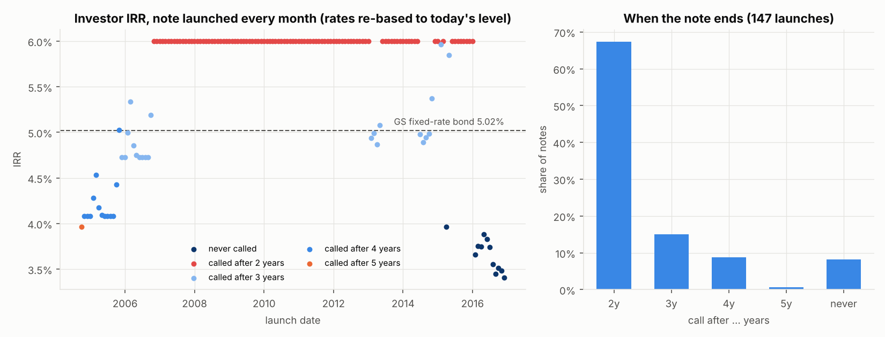

In history the curve was usually steep, so Goldman would have called **67% of the notes after
2 years**: the investor got 6% for two years and had to reinvest. The average IRR was 5.5%, a bit
above the 5.0% of a Goldman bond. The 8% of notes never called
(launched in 2015-2016, just before the curve flattened) returned only 3.4-4.0%.

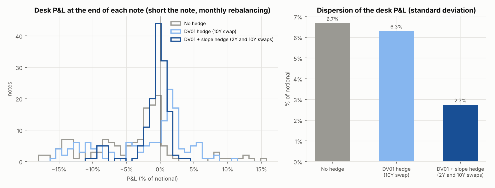

The desk is short each note, funds it at its own rate and rebalances its hedge every month. The
spread of its final P&L across the 147 notes is 6.7% of notional with no hedge and 6.3% with a DV01
hedge alone (10Y swap). With a DV01 + slope hedge (2Y and 10Y swaps) it falls to **2.7%**. A DV01
hedge alone barely helps, because this note is a slope product.

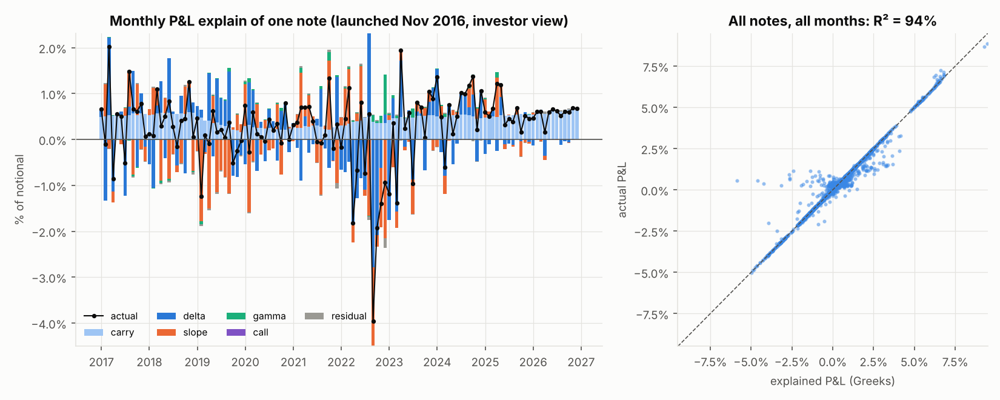

Every month, I split the note's P&L into carry, delta (DV01 x parallel move), slope (Slope01 x 2s10s
move), gamma, the call and a residual. Over all notes and all months, the Greeks explain **94%** of
the P&L. The residual comes from the months when the call is close to being exercised.
